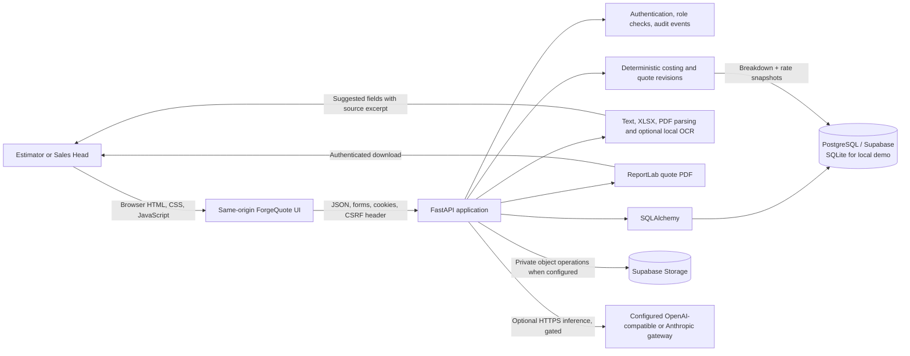

# ForgeQuote

**An RFQ intake, costing, approval, and quotation workspace for manufacturing estimators.**

[](https://www.python.org/)
[](https://fastapi.tiangolo.com/)
[](https://www.sqlalchemy.org/)
[](https://www.postgresql.org/)

ForgeQuote is a full-stack engineering prototype built from a manufacturing RFQ brief. It gives estimators one place to capture multi-part requests, cost parts from effective-dated rates, retain quote revisions and rate snapshots, and send revisions through Sales Head review. The responsive browser UI is backed by a FastAPI application and a relational database.

> **Project status:** Review build; not a production deployment. No live application URL or client-provided quote workbook/drawing set is available. See [Known limits](#known-limits) and [deployment.md](deployment.md).

## Contents

- [Problem and scope](#problem-and-scope)
- [Implemented capabilities](#implemented-capabilities)
- [Architecture](#architecture)
- [Technology choices](#technology-choices)
- [Application workflow](#application-workflow)
- [Cost model and data design](#cost-model-and-data-design)
- [AI and document intake](#ai-and-document-intake)
- [Repository map](#repository-map)
- [Run locally](#run-locally)
- [Configuration](#configuration)
- [API overview](#api-overview)
- [Tests](#tests)
- [Security and operations](#security-and-operations)
- [Screenshots and demo](#screenshots-and-demo)
- [Known limits and next steps](#known-limits-and-next-steps)
- [Contributing](#contributing)
- [License and acknowledgements](#license-and-acknowledgements)
- [Author](#author)

## Problem and scope

The supplied brief describes RFQs arriving as emails, Excel part lists, and drawings. Estimators currently gather material and machine rates from separate sources, calculate quotes manually, and have difficulty retrieving previous quotes. ForgeQuote focuses on the stated core build: an RFQ register, part costing at multiple volumes, versioned rates, estimator and Sales Head roles, approval, and PDF quotation output.

The supplied business case estimates 9,000 estimator hours and ₹40.5 lakh of annual estimating effort, plus ₹86.4 lakh of contribution at risk from late responses. These are **figures from the brief**, not measured outcomes from this software. The project does not claim achieved turnaround or savings.

## Implemented capabilities

| Capability | Implementation |
| --- | --- |
| RFQ register | Due dates, owners, multi-part RFQs, search/filter, status, and lost reason. Sales Head can reassign ownership; estimators can edit RFQs they own. |
| Part costing | Material, gross weight, scrap, one or more routing operations, cycle time, machine rate, overhead, packing, freight, and markup. Calculates two or three volume scenarios. |
| Effective-dated rates | Material and machine rate versions with effective dates. The estimator selects the rate active on the costing date. |
| Quote history | Quote revisions retain the formula version, inputs/breakdown, rate IDs and values, volume scenarios, and GST rate used. History search is paginated. |
| Intake | Text/email, `.xlsx`, and PDF intake. Text extraction and local OCR can suggest RFQ/part fields; spreadsheet intake supports worksheet selection and column mapping. Uploaded source documents are retained with the RFQ. |
| Routing assistance | Historical matching returns recorded routing keys and identifies the matching past part/RFQ. Suggestions need estimator review; this is historical matching, not an AI-generated manufacturing process plan. |
| Review and quote | Estimator submits a revision. Sales Head approves or returns it with a reason. The app generates a PDF cost breakup, shows GST separately, and supports manual “sent” status. |
| Historical quote import | `.xlsx` preview, worksheet and column selection, row validation, duplicate checks, synthetic-data marking, and explicit commit to searchable history. |
| Assistant | Optional gateway-backed assistant answers using RFQ/history context. It does not calculate costs or approve a quote. Gateway state and failures are surfaced to the user. |
| Sample workspace | The three sample RFQs from the brief plus fictional, visibly marked synthetic rows populate a local demo database. |

## Architecture



The browser assets are served by FastAPI from `frontend/`; there is no separate frontend build or deployment. SQLAlchemy models describe the relational data, and Alembic migrations evolve the schema. SQLite is the default local database. PostgreSQL is supported for hosted/review environments. Source files use a private Supabase Storage bucket when storage credentials are configured; local demo uploads are written under ignored `instance/uploads/`.

## Technology choices

| Area | Technologies | Why they are here |
| --- | --- | --- |
| UI | HTML, CSS, vanilla JavaScript | Small same-origin app without a frontend build chain; the UI calls the JSON API using `fetch`. |
| API | Python, FastAPI, Pydantic, Uvicorn | Typed request validation, HTTP endpoints, and a single service for browser assets and API. |
| Persistence | SQLAlchemy 2, SQLite, PostgreSQL, Alembic | Relational workflow data with local setup and versioned schema changes. `psycopg` is the PostgreSQL driver. |
| Spreadsheet/document handling | openpyxl, pypdf, PyMuPDF, Pillow, pytesseract | XLSX intake/import, PDF text extraction, and optional local OCR. Tesseract itself is an external host executable. |
| AI integration | httpx, OpenAI-compatible Chat Completions/Responses and Anthropic Messages protocols | Optional inference through a configured gateway. No model training, embeddings, or vector database are implemented. |
| Quote output | ReportLab | Generates the downloadable PDF from the saved revision and its snapshots. |
| Verification | pytest, FastAPI TestClient/httpx | Formula and workflow tests, including access control, import provenance, PDF access, pagination, and a synthetic 1,400-row workbook case. |

## Application workflow

```mermaid
sequenceDiagram
    actor E as Estimator
    participant UI as ForgeQuote UI
    participant API as FastAPI
    participant DB as PostgreSQL or SQLite
    actor S as Sales Head
    E->>UI: Add RFQ and one or more parts
    UI->>API: Validate and create RFQ; attach retained source files
    API->>DB: Save RFQ, parts, source metadata, audit event
    E->>UI: Review intake suggestions and edit routing/cost inputs
    E->>API: Calculate at 2 or 3 volume points
    API->>DB: Save revision, deterministic breakdown, effective-rate snapshots
    E->>API: Submit revision
    API->>DB: Queue review; retain revision state
    S->>API: Approve or return with reason
    API->>DB: Record reviewer decision and audit event
    S->>UI: Download PDF and manually send quote
    UI->>API: Mark sent; later record won/lost outcome
```

The UI handles loading, empty, validation, and request-error states. A quote is marked sent only after the Sales Head has manually dispatched it; email delivery is not integrated.

## Cost model and data design

Cost calculations are implemented in [`backend/costing.py`](backend/costing.py) using `Decimal` arithmetic and half-up rounding to two decimal places. Model output is never used for pricing.

For a part and one selected routing:

```text
material cost = gross weight × material rate per kg ÷ (1 − scrap fraction)
process cost  = Σ(operation cycle minutes ÷ 60 × machine rate per hour)
unit cost     = material cost + process cost + overhead + freight + packing
unit price    = unit cost × (1 + markup fraction)
annual value  = unit price × selected annual volume
```

Each part receives the same calculated unit price at each volume point; volume-tier pricing, tooling amortization, and price breaks are not modeled. GST is added separately using `GST_RATE_PERCENT`, defaults to 0, and is copied into each quote revision. The approval rule uses the total annual value at the largest selected volume across the RFQ parts, before GST. Every revision is routed through Sales Head review in this build; the ₹25 lakh threshold is exposed in the quote context but is not used to bypass review for smaller values.

### Main records

| Record | Purpose |
| --- | --- |
| `User` | Named demo/bootstrap account and role (`estimator` or `sales`). |
| `RFQ`, `Part`, `RoutingOperation` | Register entry, part inputs, and ordered multi-operation routing. |
| `RateVersion` | Material or machine rate key and effective period. |
| `QuoteRevision` | Saved quote scenario and breakdown, formula version, annual value, GST snapshot, and rate snapshot. |
| `Approval`, `AuditEvent` | Sales decision and traceable workflow actions. |
| `RFQSource` | File metadata and extraction status for an RFQ source document. |
| `HistoricalQuote` | Imported quote-history row with workbook/row provenance and synthetic marker. |

The schema is in [`backend/models.py`](backend/models.py); ordered migrations are in [`migrations/versions/`](migrations/versions/).

## AI and document intake

The optional adapter in `backend/main.py` sends requests to the configured `AI_BASE_URL` with `AI_MODEL` and `AI_API_KEY`. It can use OpenAI-compatible Chat Completions or Responses, or Anthropic Messages. Provider errors, empty output, and unconfigured AI produce explicit unavailable/error states; the app does not label rule-based extraction as an AI result.

For intake, the application parses email/text, spreadsheet rows, and selectable PDF text locally. Image-only pages use host-installed Tesseract OCR. When model processing is permitted, the prompt asks for a limited set of RFQ fields; returned values are accepted only when a supporting excerpt appears in the source text. Suggestions carry source/excerpt and confidence, remain unaccepted until estimator review, and can be edited or discarded. Excel part suggestions also require row selection. Routing suggestions come from similar historical records and show their origin.

`AI_NDA_APPROVED` defaults to `false`. With it disabled, hosted inference is restricted to a user-confirmed synthetic-only intake or synthetic demo context. The client’s actual no-training/NDA terms have not been verified in this repository; do not enable customer-data inference until the client approves the provider terms. OCR runs locally; no CAD/3D analysis is present.

## Repository map

```text
.
├── backend/
│   ├── main.py             # FastAPI routes, intake, AI adapter, PDF and storage operations
│   ├── models.py           # SQLAlchemy entities
│   ├── costing.py          # Deterministic Decimal pricing formula
│   ├── database.py         # SQLite/PostgreSQL engine and sessions
│   ├── security.py         # Password hashing, in-memory sessions, CSRF checks
│   ├── seed.py             # Fictional local demo data
│   └── bootstrap.py        # Create named hosted users from private environment settings
├── frontend/               # Served HTML, CSS, and vanilla JavaScript
├── migrations/             # Alembic environment and schema history
├── tests/                   # Cost and workflow tests
├── scripts/build_submission.py # Builds the TDD PDF and two-file hand-in ZIP
├── .env.example             # Safe local configuration template
├── deployment.md            # Local and hosted setup notes
├── TDD.md                   # Technical Design Document source
└── requirements.txt         # Python dependencies
```

## Run locally

Prerequisite: Python 3.12 or newer. A local demo uses SQLite and does not require Supabase or an AI API key.

```bash
git clone https://github.com/MoAftaab/isocodelabs.git
cd isocodelabs
python -m venv .venv
```

Activate the environment and install dependencies:

```bash
# macOS / Linux
source .venv/bin/activate
python -m pip install -r requirements.txt
```

Windows PowerShell:

```powershell
.\.venv\Scripts\Activate.ps1
python -m pip install -r requirements.txt
```

Create local configuration, apply the schema, and start the app:

```bash
# macOS / Linux
cp .env.example .env
```

Windows PowerShell:

```powershell
Copy-Item .env.example .env
```

Then apply the schema and start the app:

```bash
python -m alembic upgrade head
python -m uvicorn backend.main:app --reload --host 127.0.0.1 --port 8000
```

Open <http://127.0.0.1:8000>. SQLite seeds the three RFQs from the brief and additional clearly labeled fictional examples on first start. Demo accounts are documented in [deployment.md](deployment.md); they are for local review only and must not be used in a shared deployment. For hosted configuration and bootstrap details, follow [deployment.md](deployment.md).

There is no Dockerfile or Docker Compose configuration in this repository. For local OCR, install the Tesseract executable and appropriate language data separately; set `TESSERACT_CMD` if it is not on `PATH`.

## Configuration

The complete safe template is [`.env.example`](.env.example). Copy it to `.env`; `.env` and local data directories are ignored by Git. Do not commit real credentials, drawings, or customer records.

| Variable | Use | Default / requirement |
| --- | --- | --- |
| `DATABASE_URL` | SQLAlchemy connection | Local SQLite in `.env.example`; set a private PostgreSQL URI for Supabase/PostgreSQL. Supabase TLS is required by the connection helper when omitted. |
| `SESSION_SECRET` | Reserved session configuration | Read/generated by the current security module, but in-memory sessions use random tokens and do not depend on this value. It does not make sessions durable or shared. |
| `APP_ENV` | Present in the example template | Currently informational; the application does not switch behavior based on it. |
| `COOKIE_SECURE` | Mark session cookie secure | `false` locally; use `true` behind HTTPS. |
| `GST_RATE_PERCENT` | Separate GST display and revision snapshot | `0` until Finance supplies and approves a rate. Zero is not a tax determination. |
| `SUPABASE_URL`, `SUPABASE_SECRET_KEY` | Private source-file storage | Optional locally; server-only secret. Never use a publishable key for privileged Storage operations. |
| `SUPABASE_STORAGE_BUCKET` | Private RFQ document bucket | `rfq-source-documents`. |
| `AI_BASE_URL`, `AI_PROTOCOL`, `AI_MODEL`, `AI_API_KEY` | Optional inference gateway | URL/protocol/model have demo defaults; key is blank. Add a provider-issued key privately to enable requests. |
| `AI_NDA_APPROVED` | Allow hosted inference under client-approved terms | `false`; leave disabled until applicable no-training/NDA terms are verified. |
| `TESSERACT_CMD`, `OCR_LANGUAGE` | Local scanned-document OCR | Optional executable path; language defaults to `eng`. |
| `UPLOAD_DIR` | Local source and temporary import files | `instance/uploads` under the repository. Use private persistent storage for a hosted service. |
| `BOOTSTRAP_ESTIMATOR_USERNAME`, `BOOTSTRAP_ESTIMATOR_PASSWORD`, `BOOTSTRAP_SALES_USERNAME`, `BOOTSTRAP_SALES_PASSWORD` | Create named hosted users | Optional; use unique private credentials with `python -m backend.bootstrap`. |
| `SEED_DEMO_DATA` | Seed fictional examples in non-SQLite environments | Leave off for customer environments; enable only for an intentional demo database. |

`AI_ORIGINATOR` and `AI_USER_AGENT` can optionally override headers sent by the OpenAI-compatible adapter. Never add any secret value to `.env.example`.

## API overview

The API is same-origin under `/api`. Sign in at `POST /api/auth/login`; the response includes `csrf_token`, and mutating authenticated requests send it in `x-csrf-token`. Session cookies are HTTP-only. Requests are validated with Pydantic, and role/ownership checks are enforced in the backend. Full request schemas are defined in `backend/main.py`.

| Method | Endpoint | Access | Purpose |
| --- | --- | --- | --- |
| `GET` | `/api/health` | Public | Database/provider/storage status indicators. |
| `POST` | `/api/auth/login` | Public | Create session and return user plus CSRF token. |
| `POST` | `/api/auth/logout` | Signed in + CSRF | End current session. |
| `GET` | `/api/me` | Signed in | Current user and CSRF token. |
| `GET` | `/api/users/estimators` | Sales Head | List active estimators for owner reassignment. |
| `GET`, `POST` | `/api/rfqs` | Signed in; create is estimator-only | Search/filter register or create an RFQ with parts and retained source file IDs. |
| `GET`, `PATCH` | `/api/rfqs/{rfq_id}` | Signed in; edits owner-estimator or Sales Head | Read details or update RFQ header. |
| `PATCH` | `/api/rfqs/{rfq_id}/owner` | Sales Head | Reassign owner to an estimator. |
| `PATCH` | `/api/parts/{part_id}` | Estimator with RFQ ownership | Update part inputs or routing operations. |
| `GET`, `POST` | `/api/rates` | Signed in; create is Sales Head-only | Read rate master or add an effective-dated rate. |
| `POST` | `/api/rfqs/{rfq_id}/cost` | Estimator with RFQ ownership | Calculate and persist a quote revision for 2–3 distinct volumes. |
| `POST` | `/api/revisions/{revision_id}/submit` | Estimator | Submit a revision for review. |
| `GET` | `/api/approvals` | Sales Head | List revisions awaiting review. |
| `POST` | `/api/revisions/{revision_id}/decision` | Sales Head + CSRF | Approve or return a revision with a reason. |
| `GET` | `/api/revisions/{revision_id}/pdf` | Signed in | Download the saved quote PDF. |
| `POST` | `/api/revisions/{revision_id}/sent` | Sales Head + CSRF | Record that the approved quote was manually sent. |
| `POST` | `/api/rfqs/{rfq_id}/outcome` | Sales Head + CSRF | Record won/lost status and loss reason. |
| `GET` | `/api/history` | Signed in | Search historical quotes with pagination. |
| `POST` | `/api/imports/preview`, `/api/imports/{batch_id}/commit` | Estimator + CSRF | Map/validate an XLSX worksheet, preview rows, then commit history. |
| `POST` | `/api/intake/file-extract`, `/api/intake/extract` | Estimator for file; signed in for text | Extract suggestions from a file or supplied text. |
| `POST` | `/api/rfqs/{rfq_id}/sources`, `GET /api/sources/{file_id}` | Signed in; upload is estimator-only | Attach and retrieve retained source documents. |
| `GET` | `/api/parts/{part_id}/routing-suggestions` | Signed in | Find historical routing matches with source records. |
| `GET` | `/api/assistant/status`, `POST /api/assistant/chat` | Signed in | Check optional gateway status or ask a history-grounded question. |

Example request bodies:

```json
// POST /api/auth/login
{"username":"estimator@demo.local","password":"estimate-demo"}
```

```json
// POST /api/rfqs
{
  "rfq_number": "RFQ-DEMO-001",
  "customer": "Company B (two-wheelers)",
  "due_date": "2026-12-01",
  "parts": [{
    "part_name": "Rear wheel spindle",
    "material": "EN8",
    "gross_weight_kg": 0.61,
    "annual_volume": 180000,
    "cycle_time_min": 3.2,
    "machine_rate_key": "Turning cell"
  }]
}
```

```json
// POST /api/rfqs/{rfq_id}/cost
{"volumes":[25000,75000,180000]}
```

The cost endpoint returns `revision_id`, `breakdown`, `rate_snapshots`, `gst_rate_percent`, separate GST annual value, and the total including GST. Authenticated failures use HTTP errors with a readable `detail` message. The interactive API schema is available at `/docs` while the app is running.

## Tests

Run the test suite from the repository root:

```bash
python -m pytest -q
```

Tests use isolated temporary SQLite databases and do not need live Supabase or AI credentials. Coverage includes deterministic costing and boundary validation, roles and ownership, quote approval/PDF access, effective-rate snapshots, repeated routing edits, source extraction errors, Excel mapping and provenance, worksheet selection, history pagination, separate GST snapshots, and synthetic 1,400-row import/search.

## Security and operations

- Passwords are stored using salted PBKDF2-HMAC-SHA256. Session cookies are HTTP-only; mutating requests require a CSRF token. Roles and RFQ ownership are checked server-side.
- Source documents are served only to authenticated users. Supabase Storage is configured as private when enabled; configure retention, backups, and access policies for a hosted environment.
- `.env`, local SQLite data, upload directories, temporary files, and Supabase CLI temporary state are Git-ignored. Review repository changes before committing real drawings or credentials.
- AI keys and database credentials are read from private environment configuration. Provider errors do not yield fabricated answers. Customer content must remain out of hosted inference until the client approves provider terms.
- The current session store is process-local, expires after 12 hours, and loses sessions when the server restarts. A multi-instance deployment needs durable shared sessions, secure cookies, TLS, backups, monitoring, and an operational retention policy.
- The code has explicit health and AI status endpoints, but no centralized logging/metrics/alerting integration is configured.

## Screenshots and demo

No screenshot assets or public hosted demo are included. To add verified captures, save them under `docs/screenshots/` and link the RFQ register, costing workspace, approval review, and PDF quote below. Avoid screenshots containing real customer names, drawings, credentials, or contact details.

```text
docs/screenshots/rfq-register.png
docs/screenshots/costing-workspace.png
docs/screenshots/approval-review.png
docs/screenshots/quote-pdf.png
```

## Known limits and next steps

### Known limits

- The customer's original 1,400-row workbook and drawing samples were not supplied. The import path is tested with synthetic data; workbook-specific mapping and data quality still need client validation.
- Scanned PDFs require host-installed Tesseract and language data. OCR quality has not been validated on customer drawings; CAD/3D drawing analysis is out of scope.
- GST remains at 0 until Finance supplies an approved rate. The costing assumptions (scrap as gross-up, markup vs. gross margin, allocations, and no tooling amortization) also need client confirmation.
- The no-training/NDA status of a hosted AI provider is not asserted here. Customer-data inference remains gated pending client verification and approval.
- Session storage is in-memory. Import preview batches are temporary local files and are lost if the process restarts. Email delivery, ERP integration, supplier portal, Plant Head and MD roles/sign-off are outside the core build.
- No production deployment, load benchmark, or production readiness claim is made.

### Next engineering steps

1. Validate formulas, GST treatment, approval semantics, and rate governance with Company A Finance, Sales, and Estimation.
2. Run the actual historical workbook through a reviewed mapping/import and reconcile record counts and provenance.
3. Validate OCR and extraction on approved, sanitized drawing samples; add a reviewed evaluation set before enabling hosted customer-data inference.
4. Move sessions and temporary imports to durable stores, establish file retention/backups, and add structured logs, metrics, and alerts.
5. Add an approved hosted deployment, security review, and browser screenshots after environment setup.

Implemented features are described above; this list is planned work, not functionality already claimed.

## Contributing

This is an individual review-build repository and does not yet define a formal contribution process. For a proposed change, open an issue describing the problem and expected behavior, then submit a focused pull request with tests for changes to formulas, access control, or workflow state. Do not include customer data or secrets.

## License and acknowledgements

No license file is currently included. Check with the maintainer before redistributing or reusing the code. The product scope and the three named sample RFQs come from the Company A brief supplied for this project; additional seed rows are fictional and labeled synthetic.

## Author

**Mohd Aftaab** · [GitHub profile](https://github.com/MoAftaab)

LinkedIn and portfolio links were not supplied for this project, so they are not listed here.
